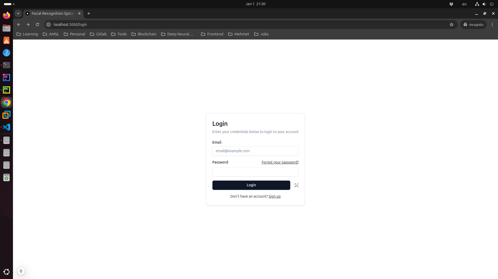
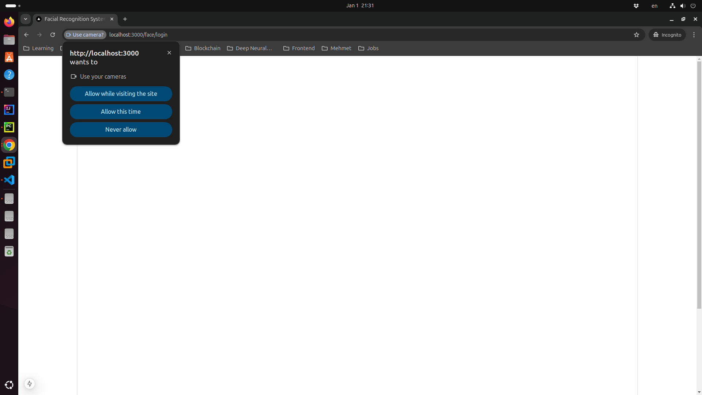

# Face Recognition Application

[](https://hub.docker.com/r/meheditech/frs-backend)

## Overview

**Face Recognition Application** is a cutting-edge facial recognition application built with modern technologies. It supports face detection, keypoint extraction and embedding generation. The app is optimized for high performance and accuracy, designed for use in identity verification, security and other facial recognition applications.

## Features

- **On-device embeddings**: the browser and the Android/iOS app detect, align and embed the face locally
  (512-d ArcFace / MobileFaceNet). Only the vector is sent to the server - never a photo.
- **Guided registration**: frontal, left/right and up/down samples, checked with head pose (yaw, pitch, roll)
  measured relative to the user's own frontal pose.
- **Fast identification**: no pose requirement; quality-gated frames, 3-frame fusion, vector search in Qdrant.
- **Web, Android and iOS share one vector space**: same model file, same alignment, tested against shared
  golden values.
- **Legacy server-side inference** (RetinaFace + ArcFace r100, PyTorch) is still available for photo uploads.

See [docs/client-side-embeddings.md](docs/client-side-embeddings.md) for the design, the performance analysis
of the previous webcam flow and security notes.

## Repository layout

| Path | What |
| --- | --- |
| `frontend/frs_react` | Next.js web app: on-device pipeline in `src/face`, examples under `/examples` |
| `mobile/face_app` | Flutter app (Android & iOS): ML Kit landmarks + ONNX Runtime Mobile |
| `backend/frs` | FastAPI: embedding store/search (`/api/v1/embeddings`), legacy image endpoints, Python reference pipeline |
| `shared/test-vectors` | golden values every implementation is tested against |
| `frontend/web`, `frontend/frs-frontend`, `frontend/frs_express` | earlier prototypes (unchanged) |

## Technologies Used

- **Frontend**: React.js, Nextjs, MediaPipe Face Landmarker, ONNX Runtime Web (WebGPU / WASM, Web Worker)
- **Mobile**: Flutter, Google ML Kit face detection, ONNX Runtime Mobile
- **Embedding model (clients)**: MobileFaceNet ArcFace `w600k_mbf` (InsightFace, 512-d)
- **Backend**: Python (FastAPI)
- **Face Detection - Backend**: PyTorch, RetinaFace
- **Face Recognition - Backend**: PyTorch, ArcFace
- **Face Detection - Frontend**: Tensorflowjs, Mediapipe
- **Database**: Qdrant (Vector Database), PostgreSQL (Optional for storage)
- **Containerization**: Docker

## Quick start (client-side embeddings)

```bash
# 1. backend - embedding-only mode needs neither torch nor model weights
cd backend/frs
pip install -r requirements-api.txt
cd src && QDRANT_LOCATION=:memory: FRS_ENABLE_SERVER_INFERENCE=false uvicorn api.server:app --port 5000
#    (drop QDRANT_LOCATION to use the Qdrant server from docker-composes/qdrant.yml)

# 2. web app - `npm run dev` downloads the models into public/ on first start
cd frontend/frs_react
npm install
npm run dev            # http://localhost:3000  ->  /registration, /face/login, /examples

# 3. mobile app
cd mobile/face_app
tool/setup_models.sh && flutter run --dart-define=FRS_API=http://<your-ip>:5000
```

### Embedding API

| Method | Endpoint | Body |
| --- | --- | --- |
| `POST` | `/api/v1/embeddings/register` | `{model, person: {person_id, name, email, ...}, samples: [{embedding, pose_label, pose: {yaw, pitch, roll}, quality}]}` |
| `POST` | `/api/v1/embeddings/identify` | `{model, embedding, top_k?, threshold?}` -> `{status, reason, score, person, candidates}` |
| `DELETE` | `/api/v1/embeddings/persons/{person_id}?model=` | removes all vectors of a person |
| `GET` | `/api/v1/health` | enabled models / modes |

`embedding` is either a JSON array of 512 floats or base64 of little-endian float32 (what the clients send).

## Examples

- Web: `/examples/pipeline` (live timings, pose, quality, aligned crop, similarity to a reference),
  `/examples/compare` (two photos compared in the browser), quick frontal-only registration.
- Python: `backend/frs/examples/client_embedding_demo.py embed|compare|register|identify|benchmark --image ...`
  computes embeddings exactly like the clients (useful for enrolling from photos and tuning thresholds).
- Export your own backbone: `backend/frs/tools/export_onnx.py`.

## Tests

```bash
cd backend/frs && pip install -r requirements-dev.txt && pytest          # pipeline, service, API (in-memory Qdrant)
cd frontend/frs_react && npm test && npm run lint && npx tsc --noEmit     # vitest
cd mobile/face_app && flutter analyze && flutter test
```

End-to-end browser test with a fake webcam: `frontend/frs_react/e2e/face-flow.mjs` (instructions in the file).

## Installation (legacy server-side inference)

### Prerequisites

Ensure you have the following installed:

- Node.js (v22 or higher)
- Python (v3.12 or higher)
- Docker (Optional, for containerized setup)
- CUDA Toolkit (Optional, for GPU acceleration)

### Steps

1. Clone the repository:

    ```bash
    git clone https://github.com/rabbicse/face-app.git
    cd face-app
    ```

2. Install dependencies for the frontend:

    ```bash
    cd frontend/frs_react
    npm install
    ```

3. Set up the backend:

    ```bash
    cd backend/frs
    pip install -r requirements.txt
    ```

4. Configure environment variables:

    - Create a `.env` file in the root directory.
    - Add the following variables:

      ```env
      NEXT_PUBLIC_API_HOST=http://localhost
      NEXT_PUBLIC_API_PORT=5000
      ```

5. Start the services:

    - Frontend:

      ```bash
      cd frontend/frs_react
      npm run dev
      ```

    - Backend:

      ```bash
      cd backend/frs
      uvicorn api.server:app --reload --host 0.0.0.0 --port 5000
      ```

6. Access the application:

    Open your browser and navigate to `http://localhost:3000`.

## Screenshots

### Login Page



### Login with Face Recognition



## API Endpoints

### 1. Detect Faces

**Endpoint:** `/api/v1/dnn/detect`

- **Method:** `POST`
- **Body:** `multipart/form-data`
  - `photo`: The image file for detection.
- **Response:**

  ```json
  {
    "status": "success",
    "faces": [
      {
        "bbox": {
          "x_min": 0.2697347104549408,
          "y_min": 0.1822991967201233,
          "x_max": 0.7142632007598877,
          "y_max": 0.7912323474884033,
          "score": 0.9963470101356506
        },
        "landmarks": {
          "left_eye": {
            "x": 0.3953465223312378,
            "y": 0.413769394159317
          },
          "right_eye": {
            "x": 0.5912481546401978,
            "y": 0.4187081754207611
          },
          "nose": {
            "x": 0.49022188782691956,
            "y": 0.5452162623405457
          },
          "left_lip": {
            "x": 0.4161381721496582,
            "y": 0.6275689005851746
          },
          "right_lip": {
            "x": 0.5787203907966614,
            "y": 0.6303802132606506
          }
        }
      }
    ]
  }
  ```

### 2. Extract Embeddings

**Endpoint:** `/api/v1/dnn/extract-embedding`

- **Method:** `POST`
- **Body:** `multipart/form-data`
  - `photo`: The image file for embedding extraction.
- **Response:**

  ```json
    {
      "status": 0,
      "embedding": "MQoaPfbAZ73Kape9Rpw...fhs="
  }
  ```

## Docker Setup

To run the application in Docker, follow these steps:

1. Build and start the containers:

    ```bash
    docker-compose up --build
    ```

2. Access the application at `http://localhost:3000`.

## Contribution

Contributions are welcome! Please follow these steps:

1. Fork the repository.
2. Create a new branch: `git checkout -b feature/your-feature-name`.
3. Commit your changes: `git commit -m 'Add some feature'`.
4. Push to the branch: `git push origin feature/your-feature-name`.
5. Open a pull request.

## License

This project is licensed under the GNU GENERAL PUBLIC License. See the [LICENSE](LICENSE) file for details.

## References
- [InsightFace](https://github.com/deepinsight/insightface)
- [tfjs-models](https://github.com/tensorflow/tfjs-models)

---

Made with ❤️ by [Mehedi Hasan](https://github.com/rabbicse)
