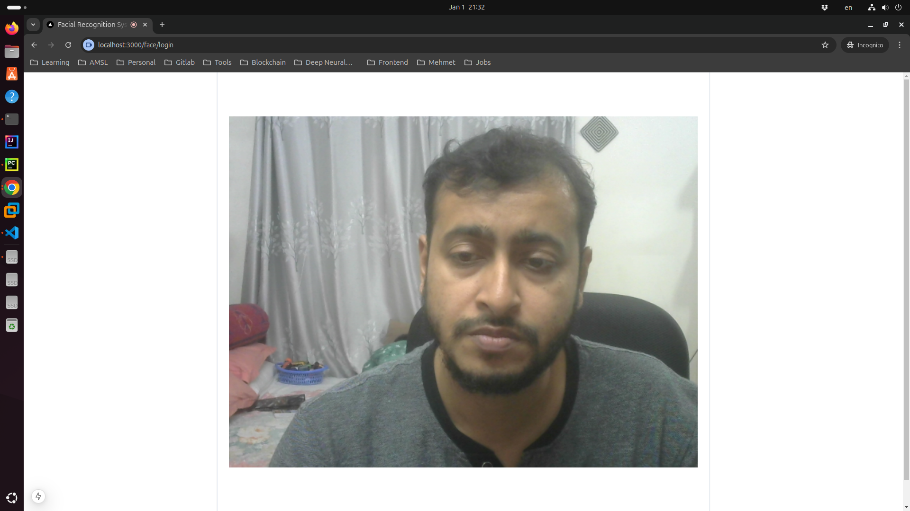

# Face Recognition Application

Face registration and login where **the device computes the face embedding** and the server only stores and
searches vectors. No photo ever leaves the browser or phone.

```bash
git clone https://github.com/rabbicse/face-app.git && cd face-app
docker compose up -d        # then open http://localhost:3000
```

**Documentation:** [step-by-step guide](docs/guide.md) ·
[deploy on the web for free](docs/deploy-free.md) ·
[Docker images](docs/docker.md) ·
[design and security notes](docs/client-side-embeddings.md)

## Features

- **On-device embeddings:** the browser and the Android/iOS app detect, align and embed the face locally
  (512-d ArcFace / MobileFaceNet).
- **Guided registration:** frontal, left/right and up/down samples, checked with head pose relative to the
  user's own frontal pose.
- **Fast identification:** 3-frame fusion and vector search in Qdrant.
- **Blink liveness:** login needs a blink, so a printed photo or a still image is refused.
- **One vector space:** web, Android and iOS use the same model and alignment, tested against shared golden
  values.

## Repository layout

| Path | What |
| --- | --- |
| `frontend/frs_react` | Next.js web app: on-device pipeline in `src/face`, examples under `/examples` |
| `mobile/face_app` | Flutter app (Android & iOS): ML Kit landmarks + ONNX Runtime Mobile |
| `backend/frs` | FastAPI embedding store/search and the Python reference pipeline |
| `shared/test-vectors` | golden values every implementation is tested against |
| `docker-compose.yml` | the full stack (web, API, Qdrant) on one machine |

The earlier prototypes and the server-side PyTorch inference stack are on the
[`stable-v01`](https://github.com/rabbicse/face-app/tree/stable-v01) branch.

## Technologies

- **Web:** Next.js 16, React 19, MediaPipe Face Landmarker, ONNX Runtime Web (WASM, optional WebGPU, Web Worker)
- **Mobile:** Flutter, Google ML Kit, ONNX Runtime Mobile
- **Embedding model:** MobileFaceNet ArcFace `w600k_mbf` (InsightFace, 512-d)
- **Backend:** Python, FastAPI, Qdrant
- **Delivery:** Docker, GitHub Actions, Docker Hub, Vercel

## API

| Method | Endpoint | Body |
| --- | --- | --- |
| `POST` | `/api/v1/embeddings/register` | `{model, person: {person_id, name, email, ...}, samples: [{embedding, pose_label, pose: {yaw, pitch, roll}, quality}]}` |
| `POST` | `/api/v1/embeddings/identify` | `{model, embedding, top_k?, threshold?}` -> `{status, reason, score, person, candidates}` |
| `DELETE` | `/api/v1/embeddings/persons/{person_id}?model=` | removes all vectors of a person |
| `GET` | `/api/v1/health` | status and accepted models |

`embedding` is either a JSON array of 512 floats or base64 of little-endian float32 (what the clients send).
Worked examples: [guide, section 5](docs/guide.md#5-use-the-api).

## Screenshots



## Contributing

1. Fork the repository and create a branch: `git checkout -b feature/your-feature-name`.
2. Run the tests ([guide, section 6](docs/guide.md#6-local-development)).
3. Open a pull request.

## License

GNU General Public License, see [LICENSE](LICENSE). The InsightFace pretrained model weights are released for
non-commercial research use only.

## References

- [InsightFace](https://github.com/deepinsight/insightface)
- [MediaPipe](https://ai.google.dev/edge/mediapipe)
- [Qdrant](https://qdrant.tech)

---

Made with ❤️ by [Mehedi Hasan](https://github.com/rabbicse)
