# Face sign-in that keeps faces on the device

Register and sign in with a face from the browser or a phone. The device does the recognition work. Photos and
video never leave it: the server only stores and searches numeric face signatures.

<p align="center">
  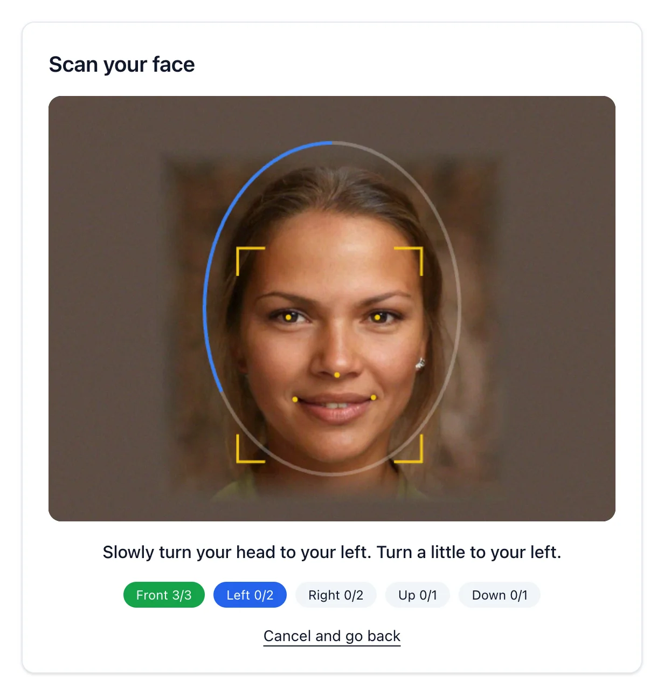
</p>

**Try it in one command** (you need a webcam, plus Python 3.11+ and Node.js 22.12+, or Docker):

```bash
git clone https://github.com/rabbicse/face-app.git && cd face-app
./run.sh          # without Docker: installs what it needs, starts everything, opens the browser
./docker.sh       # or the same stack in Docker
```

Both pick free ports by themselves (on a Mac, AirPlay often holds port 5000). `./run.sh help` lists every option.

## Why it's different

| | |
| --- | --- |
| **Private by design** | Photos and video stay on the device, and the server never needs to process an image. |
| **Fast** | 30 FPS live tracking and about 1.1 seconds from camera on to recognised, on a laptop. |
| **Cheap to run** | The user's device does the AI work, so the server needs no GPU and only runs vector search. |
| **Scales like a static site** | The web app is client-rendered with no server rendering per request, so it can be served from any CDN. |
| **Web, Android and iOS** | One shared recognition pipeline, so a face registered on one can sign in on another. |
| **Users stay in control** | The camera stays off until they agree, and they can delete their face data themselves. |

## At a glance

| | |
| --- | --- |
| Live tracking | **30 FPS** |
| Camera on to recognised | **1.14 s** |
| First visit download | **18.2 MB**, then 0 MB on repeat visits |
| Match search, 100,000 stored vectors | **13.4 ms** median |
| Face model | 512-d ArcFace MobileFaceNet, **99.70% on LFW** (published) |
| Server memory, 10,000 people | **about 950 MiB** for Qdrant, API and web server together |
| Photos sent to the server | **none** |

## Benchmarks

Measured on an Apple M1 laptop (8 cores, 16 GB) in Chromium with the production build and a simulated 640×480,
30 FPS camera. The method, ranges and how to repeat them are in [the benchmarks](docs/benchmarks.md).

**On the device**

| Stage | Median | 95th percentile |
| --- | --- | --- |
| Live tracking | **30 FPS** (the camera's limit) | |
| Finding the face landmarks (MediaPipe, GPU) | **15.9 ms** | 17.4 ms |
| Alignment and quality check | **2.2 ms** | 2.5 ms |
| Face signature (WASM in a Web Worker, 2 passes) | **70.7 ms** | 78.6 ms |

**User experience**

| Moment | Typical (median) |
| --- | --- |
| Camera button to live preview | **0.1–0.26 s** |
| Camera on to recognised (blink step excluded) | **1.14 s** |
| Quick registration, 3 samples | **1.64 s** |
| Page open to first result, first visit (18.2 MB download) | **2.2 s** |
| Page open to first result, repeat visit (nothing downloaded) | **1.5 s** |

**On a weaker setup** (same machine, with acceleration switched off)

| Condition | Live tracking | Landmarks | Face signature |
| --- | --- | --- | --- |
| Normal: hardware GPU, multithreaded WASM | **30 FPS** | 15.6 ms | 68.2 ms |
| No hardware GPU (software WebGL) | **7 FPS** | 92.6 ms | 82.1 ms |
| Not cross-origin isolated (single thread) | **30 FPS** | 13.8 ms | 86.5 ms |
| No WebGL | doesn't run | | |

**Server** (10,000 people, 100,000 vectors, Qdrant in Docker)

| Operation | Median | 95th percentile |
| --- | --- | --- |
| Find a match | **13.4 ms** | 37.9 ms |
| Register a person (10 vectors) | **101.7 ms** | 245.9 ms |

| Process | Memory with 10,000 people |
| --- | --- |
| Qdrant | 459 MiB |
| API (2 workers) | 371 MiB |
| Web server (optional; a static host needs none) | 113 MiB |

These numbers show speed, not recognition accuracy, which hasn't been measured on this pipeline. Phones, Firefox,
Safari and real low-end PCs haven't been benchmarked yet.

## System requirements

**For people using it** (the browser does the face work)

| | Minimum | Recommended |
| --- | --- | --- |
| Browser | A current Chromium browser (Chrome, Edge) with WebGL and WebAssembly SIMD | Latest Chrome or Edge |
| Graphics | Any WebGL, including software (about 7 FPS) | A hardware GPU, integrated is fine (30 FPS) |
| Processor | 2 cores | 4 or more cores (the face model uses up to 4 threads) |
| Memory | 4 GB | 8 GB |
| Camera | 640×480 | 720p, front-facing, in even light |
| Network | 18.2 MB on the first visit, then cached | |
| Page delivery | HTTPS (browsers only allow the camera on secure pages or localhost) | HTTPS with cross-origin isolation headers (about 20% faster face model) |

The minimum column comes from the weaker-setup measurements above, simulated on one M1, plus what the libraries
need. It isn't a tested low-end device.

**For running the server**

| | Minimum | Recommended |
| --- | --- | --- |
| Software | Python 3.11+ and Node.js 22.12+, or Docker | Docker, or a static host plus a managed Qdrant |
| Memory | About 1 GB for a small demo (an estimate from the figures above) | 2 GB or more; Qdrant's use grows with the number of people |
| Processor | 1 core | 2 or more cores (no GPU needed) |
| Disk | About 2 GB for dependencies, models and a build (`./run.sh`); less with Docker images | SSD for the Qdrant data |
| Database | Qdrant in-process (`.run/qdrant`) | Qdrant server or [Qdrant Cloud](docs/deploy-free.md) |

Each person takes 10 vectors of 512 numbers, about 20 KB before indexing, so a million people need roughly
20 GB of vector data. Plan Qdrant's size from that, and see Qdrant's own sizing guidance for production.

## See it in action

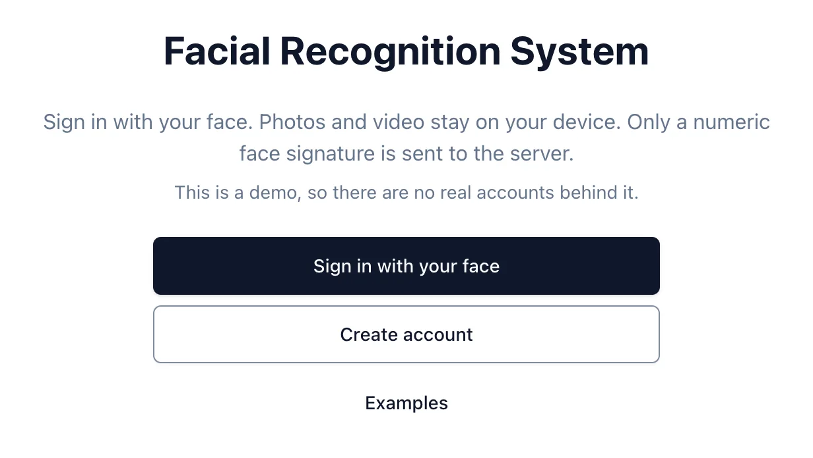

### 1. Register

| Enter your details | Agree before the camera starts |
| --- | --- |
| 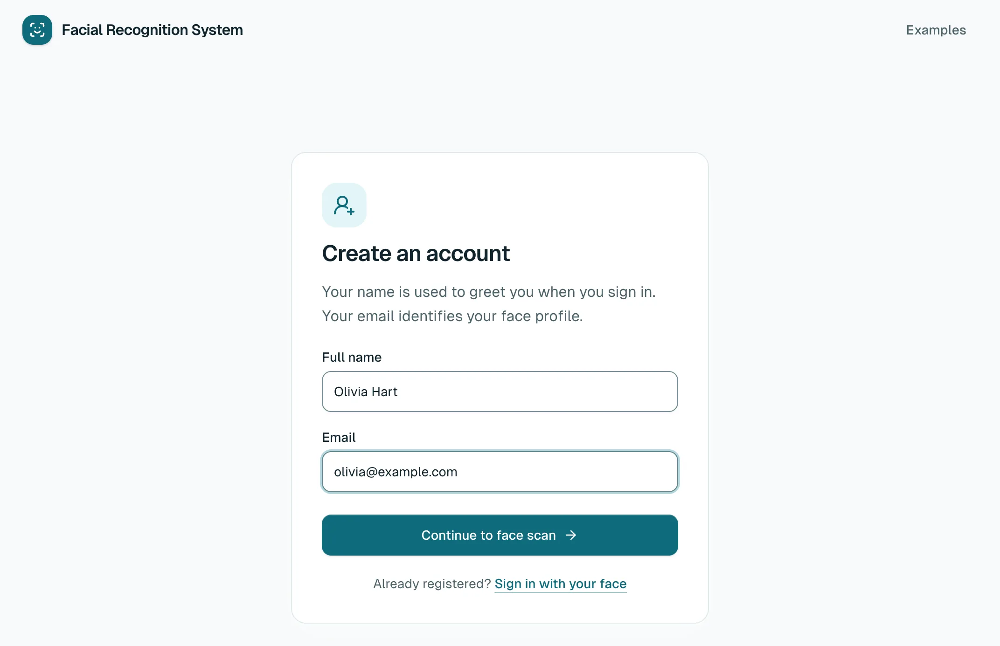 | 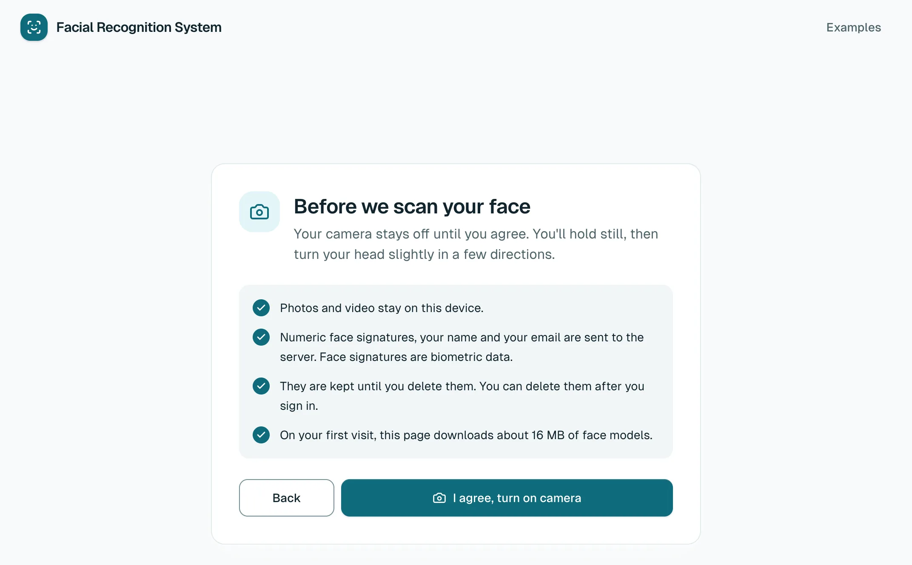 |

| Steer the dot into the target, with live 3D head axes | Done, with no shutter button |
| --- | --- |
|  | 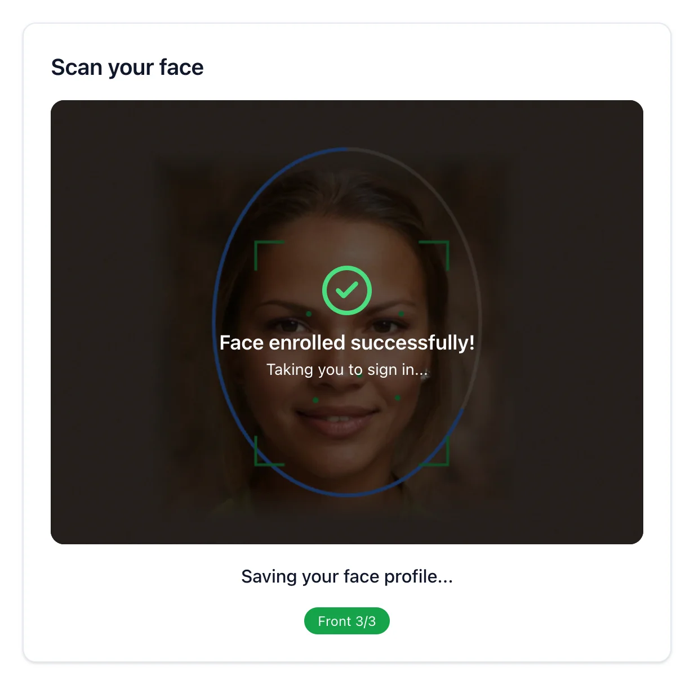 |

### 2. Sign in

| Turn on the camera | Blink to prove you're present |
| --- | --- |
| 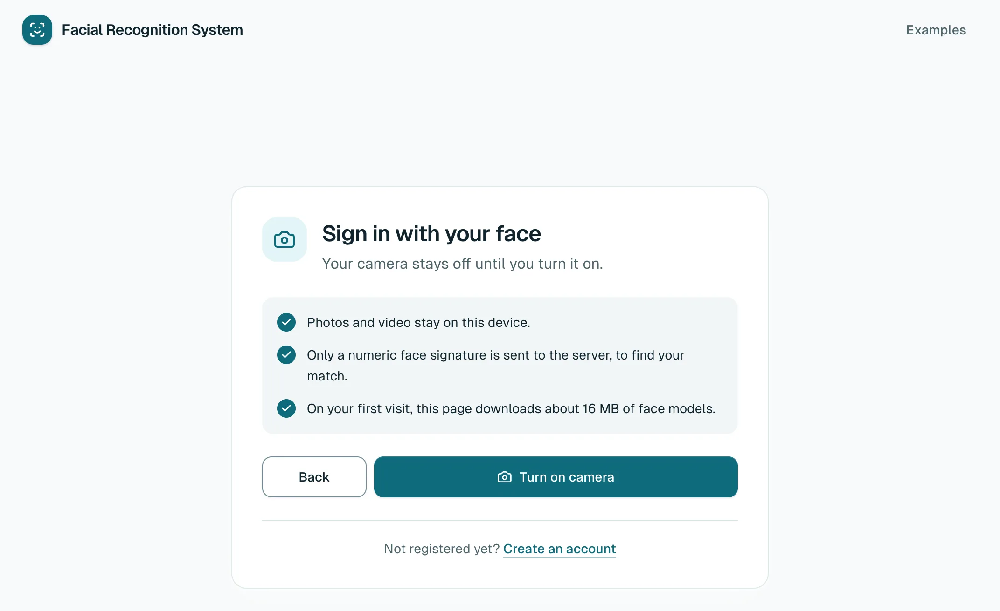 | 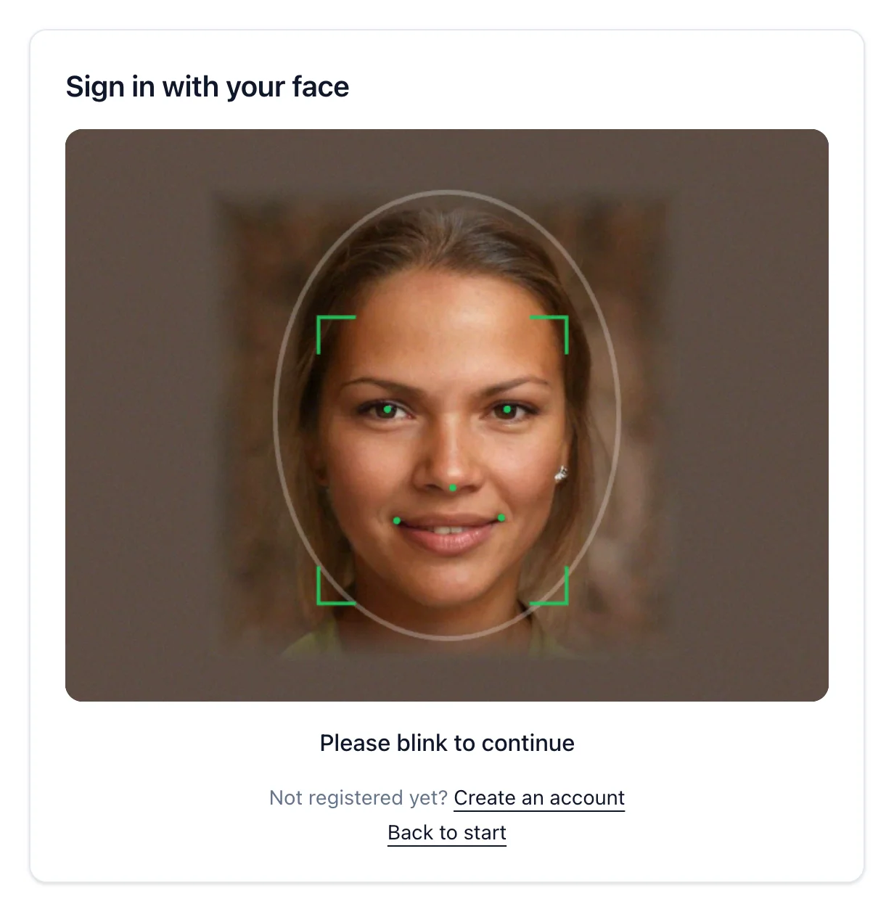 |

| Recognised | Your page, including deleting your data |
| --- | --- |
| 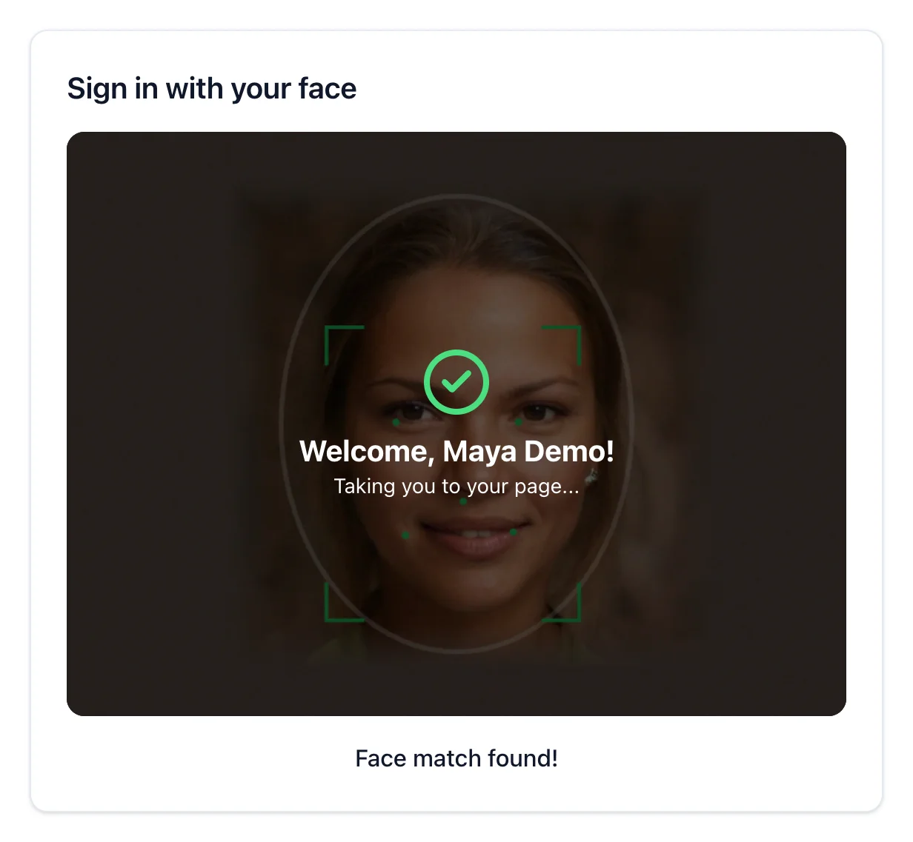 | 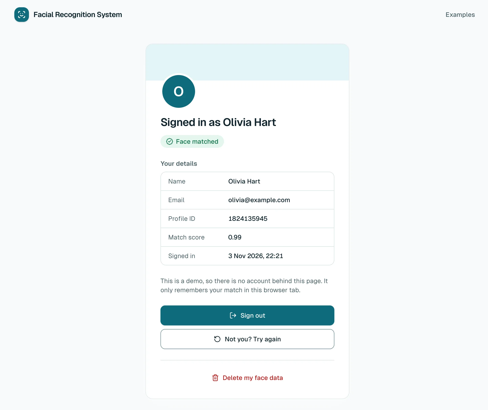 |

### 3. Delete your face data, or recover from a blocked camera

| One button, with a confirmation | Clear errors with a way out |
| --- | --- |
| 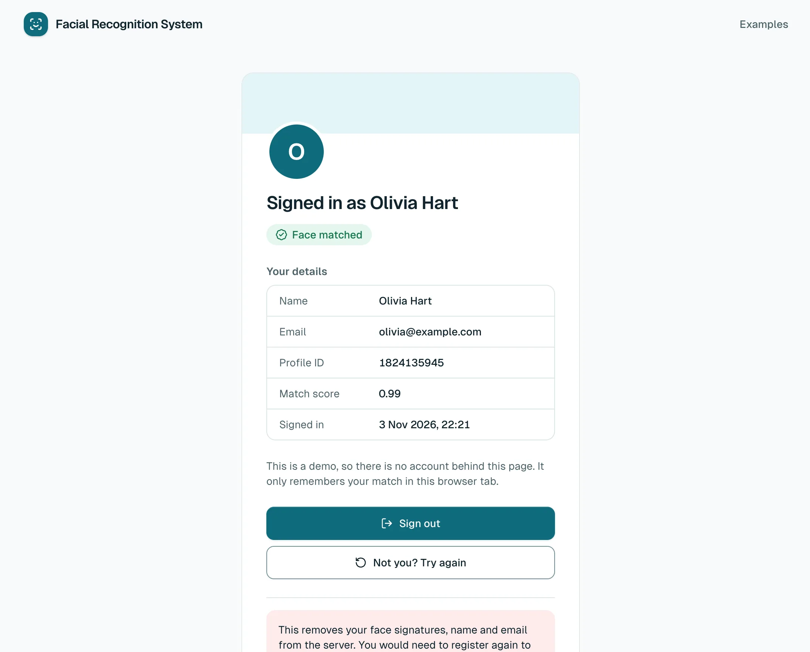 | 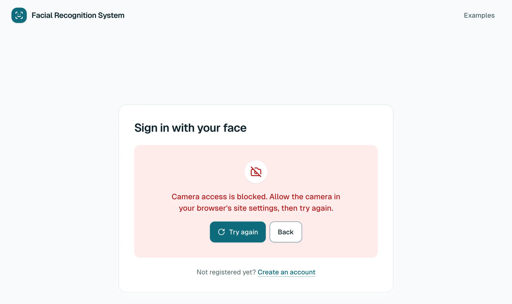 |

### 4. Compare two photos

Everything runs in the browser and nothing is uploaded. A match needs a score of at least 0.45.

| Different people: −0.08, no match | Same person: 0.98, match |
| --- | --- |
| 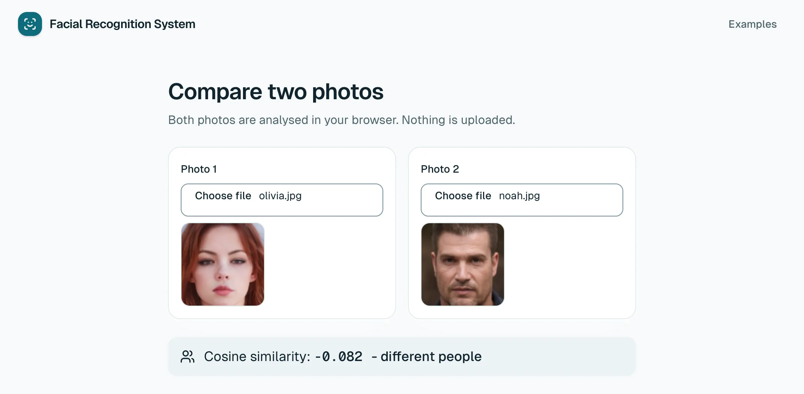 | 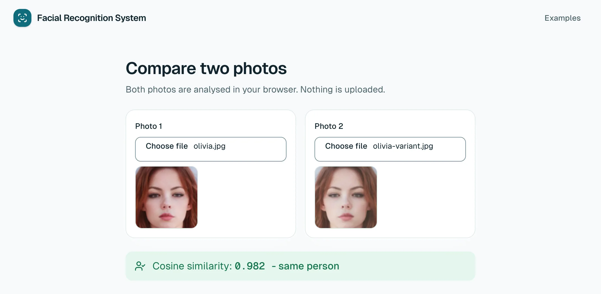 |

*The matching pair is one synthetic face, with the second copy mirrored, rotated 4°, re-cropped and re-lit. It
shows what a match looks like, not how accurate the model is on real photos.*

### 5. See under the hood

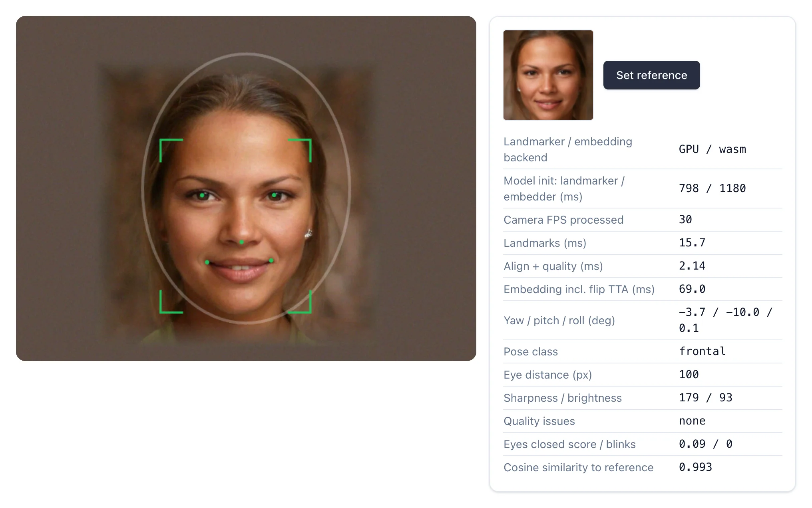

The [step-by-step guide](docs/guide.md) shows every screen, including the phone layout.

*Screenshots are real captures of the running app. The faces are AI-generated people, not real individuals (see
[credits](#credits)).*

## How it works

```
 Browser / phone                                     Server
 ┌───────────────────────────────────────┐          ┌───────────────────┐
 │ camera → find face → align            │ numbers  │ FastAPI           │
 │        → quality check → face model   │ ───────▶ │ Qdrant search     │
 │ photos and video stay here            │ only     │ no photos, no GPU │
 └───────────────────────────────────────┘          └───────────────────┘
```

1. **Registration** captures 9 samples across 5 head poses, relative to the person's own straight-ahead pose.
2. **Sign-in** combines 3 consistent frames and needs a recent blink. A match must score at least 0.45 and beat
   the next person by 0.05.
3. **Every platform shares one vector space**, kept identical by tests against shared golden values.

### Built to scale

- **The web app is client-rendered.** Every page is a static HTML shell built once; the face pipeline runs in the
  browser. `npm run build:static` turns it into plain files for any CDN or static host, with no Node.js server.
- **The server side is small.** Each sign-in is one vector search and each registration one write, so capacity
  depends on the API and Qdrant, which scale horizontally. A search took 13–38 ms at 100,000 stored vectors
  ([benchmarks](docs/benchmarks.md)).
- Load at 100,000 users hasn't been tested yet. See [deploying a static build](docs/guide.md#deploy-as-a-static-site).

## Documentation

| Guide | For |
| --- | --- |
| [Step-by-step guide](docs/guide.md) | Running it, using it, the API, and troubleshooting |
| [Benchmarks](docs/benchmarks.md) | How the numbers were measured, and how to repeat them |
| [Deploy for free](docs/deploy-free.md) | Putting it online with Vercel and Qdrant Cloud |
| [Docker images](docs/docker.md) | Image settings and tags |
| [Design and security notes](docs/client-side-embeddings.md) | Technical decisions and threat model |
| [Mobile app](mobile/face_app/README.md) | Building the Flutter app for Android and iOS |

## Before commercial use

This is a working demo. A production or commercial deployment needs these first:

- **Replace the face model.** The bundled InsightFace `w600k_mbf` weights are licensed for **non-commercial
  research only**. Train or license your own; the [design notes](docs/client-side-embeddings.md) explain how to
  swap it.
- **Check the code licence.** The code is under the [GPLv3](LICENSE), which has conditions for anyone who
  distributes it.
- **Add authentication to the API.** Registering and deleting faces are currently open to anyone who can reach
  the API, and an email address isn't verified.
- **Add stronger liveness if needed.** A blink stops printed photos and still images, but not a replayed video.
- **Take legal advice on biometric data.** Rules such as GDPR and BIPA can apply, and the consent wording in this
  demo has not been legally reviewed.

## The face model

Recognition uses InsightFace's `w600k_mbf`, a MobileFaceNet network trained with ArcFace loss on WebFace600K. It
turns an aligned 112×112 face into a 512-number signature.

| File | Used by | Where it comes from |
| --- | --- | --- |
| `w600k_mbf.onnx` (13.6 MB) | Mobile app, Python tools | Inside InsightFace's official [`buffalo_s.zip`](https://github.com/deepinsight/insightface/releases/download/v0.7/buffalo_s.zip) (v0.7 release). The setup script checks its SHA-256. |
| `w600k_mbf.fp16.onnx` (6.9 MB) | Web app | Made from the file above by [`scripts/onnx-fp16.mjs`](frontend/frs_react/scripts/onnx-fp16.mjs): the weights are stored as 16-bit numbers to halve the download. On 636 faces its signatures matched the original's (cosine ≥ 0.99998). |

Both files are downloaded and generated automatically (`npm run dev`, `npm run build`, `mobile/face_app/tool/setup_models.sh`) and
aren't committed to this repository.

**Published accuracy** for this model, from the [InsightFace model zoo](https://github.com/deepinsight/insightface/tree/master/model_zoo):

| Benchmark | `w600k_mbf` | ResNet50 (`buffalo_l`), for comparison |
| --- | --- | --- |
| LFW | 99.70% | 99.83% |
| CFP-FP (side profiles) | 98.00% | 99.33% |
| AgeDB-30 (age gaps) | 96.58% | 98.23% |
| IJB-C, at a 1 in 10,000 false-match rate | 95.02% | 97.25% |
| Mixed-race test, at a 1 in 1,000,000 false-match rate | 71.87% | 91.25% |

These are InsightFace's figures with its own face detector and alignment. This project aligns faces with MediaPipe
and uses its own match threshold, and its accuracy hasn't been measured yet. The weights are licensed for
**non-commercial research only** (see [Before commercial use](#before-commercial-use)).

## Built with

Next.js, React, MediaPipe and ONNX Runtime Web · Flutter, Google ML Kit and ONNX Runtime Mobile · FastAPI and
Qdrant · Docker and GitHub Actions. The face model is MobileFaceNet ArcFace (512 dimensions).

| Path | What |
| --- | --- |
| `frontend/frs_react` | Web app, with the on-device pipeline in `src/face` |
| `mobile/face_app` | Flutter app for Android and iOS |
| `backend/frs` | API and the Python reference pipeline |
| `shared/test-vectors` | Golden values all three implementations are tested against |

The [API reference](docs/guide.md#5-use-the-api) has worked examples. To contribute, fork the repository, run the
[tests](docs/guide.md#6-local-development) and open a pull request.

## Credits

- Demo faces: [SFHQ synthetic face dataset](https://github.com/SelfishGene/SFHQ-dataset) by David Beniaguev,
  [MIT licence](docs/images/SFHQ-LICENSE.txt).
- [InsightFace](https://github.com/deepinsight/insightface), [MediaPipe](https://ai.google.dev/edge/mediapipe)
  and [Qdrant](https://qdrant.tech).

---

Made with ❤️ by [Mehedi Hasan](https://github.com/rabbicse)
