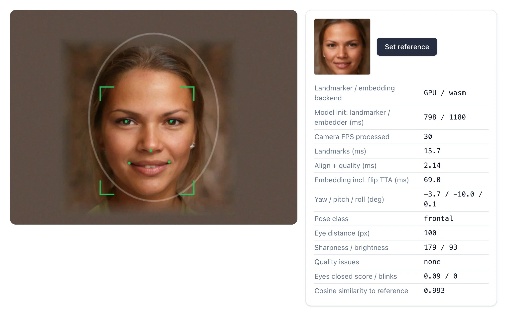

# Benchmarks

Real measurements of the web app and API, with enough detail to repeat them. Your numbers will vary with the
device, browser and camera.

**Test machine:** Apple M1 laptop (8 cores, 16 GB RAM), Chrome-family Chromium using the real GPU (Metal), with
production Docker builds of the web app and API running on the same machine. Docker had 7.75 GB of memory.

**Camera:** a simulated 640×480, 30 FPS camera showing an AI-generated face with slight movement and noise, so
every run sees the same input.

## Live processing

Sampled from `/examples/pipeline` four times a second for 60 seconds (225 samples).

| Stage | Median | 95th percentile | Range |
| --- | --- | --- | --- |
| Frames processed | 30 FPS | 31 FPS | 30–31 FPS |
| Face landmarks (MediaPipe on GPU) | 15.9 ms | 17.4 ms | 15.2–19.1 ms |
| Alignment and quality check | 2.15 ms | 2.47 ms | 1.97–2.75 ms |
| Face signature with flip pass (WASM, Web Worker) | 70.7 ms | 78.6 ms | 65.8–89.7 ms |

- 30 FPS is the camera's rate, so the pipeline may be able to go faster.
- The face signature runs in a Web Worker, at most 8 times a second, so it doesn't hold back the live preview.
- The figure above uses two passes, as registration does. Sign-in uses a single pass; that was not timed separately.

## Start-up

Time from opening `/examples/pipeline` to the first face signature on screen, in 3 fresh browser profiles.

| | First visit | Repeat visit |
| --- | --- | --- |
| Time to first result (median) | 2.19 s | 1.51 s |
| Downloaded | 18.2 MB | 0 MB |
| Landmark model start-up | about 800 ms | about 300 ms |
| Face model start-up | about 1,180 ms | about 585 ms |

The server was on the same machine, so **network time isn't included**. On a real connection, a first visit also
has to download those 18.2 MB.

## User flows

From clicking the camera button to the result, 5 runs each, with the models already loaded.

| Flow | Median | Range |
| --- | --- | --- |
| Sign in: camera on to "Welcome" | 1.14 s | 1.13–1.15 s |
| Quick registration: 3 frontal samples | 1.64 s | 1.62–1.64 s |

- **Sign-in was timed with the blink step turned off**, because a simulated camera can't blink. In real use, add
  however long the person takes to blink.
- **Full registration wasn't timed.** It has 9 samples across 5 head poses, so it depends on how quickly the person
  follows the guide.

## API and vector search

Called directly over HTTP from a Python client on the same machine, with Qdrant in Docker. Each person has 10
stored vectors (9 samples and 1 template). Registration ran 4 clients in parallel; search ran one request at a
time, 300 matches and 100 non-matches at each size.

| People | Vectors | Match: median | Match: 95th | No match: median | Register: median | Register: 95th |
| --- | --- | --- | --- | --- | --- | --- |
| 1,000 | 10,000 | 20.0 ms | 46.3 ms | 43.9 ms | 140.4 ms | 223.9 ms |
| 10,000 | 100,000 | 13.4 ms | 37.9 ms | 12.6 ms | 101.7 ms | 245.9 ms |

- The vectors were random, not real faces, so this measures **speed only**.
- The 10,000-person run being faster doesn't mean more data speeds things up. It reflects run-to-run variation on
  a single machine, so treat both rows as "tens of milliseconds".
- The register figures for the 10,000 row cover all 10,000 registrations.

Memory after loading 10,000 people: Qdrant 459 MiB, API 371 MiB (2 workers), web server 113 MiB.

## What these numbers don't show

- **Recognition accuracy.** False match and false rejection rates haven't been measured. The match score of 0.99 in
  the screenshots comes from one synthetic face seen by a simulated camera, so it says nothing about real-world
  accuracy.
- **Phones.** The Flutter app hasn't been benchmarked.
- **Other computers and browsers.** Only this M1 and Chromium were tested.
- **Heavy traffic.** Search was timed one request at a time, not under concurrent load.
- **Real cameras and lighting.** Real conditions can change detection and quality results.

## Measure it yourself

1. Run `docker compose up -d`.
2. Open <http://localhost:3000/examples/pipeline> and allow the camera.
3. Read the live timings, FPS, and which GPU or WASM backend is in use.

