# User guide

Run the app, register a face, sign in with it, then use the API and put it on the web. If you only want to try
it, sections 2 and 3 take about five minutes.

*Screenshots are real captures of the running app. The faces are AI-generated people, not real individuals.*

1. [How it works](#1-how-it-works)
2. [Run it with one command](#2-run-it-with-one-command)
3. [Demo: register and log in](#3-demo-register-and-log-in)
4. [Explore the examples](#4-explore-the-examples)
5. [Use the API](#5-use-the-api)
6. [Local development](#6-local-development)
7. [Mobile app](#7-mobile-app)
8. [Configuration](#8-configuration)
9. [Deploy on the web for free](#9-deploy-on-the-web-for-free)
10. [Troubleshooting](#10-troubleshooting)

## 1. How it works

The device does the face recognition work. The server never sees a photo.

```
 Browser / phone                                          Server
 ┌────────────────────────────────────────────┐          ┌─────────────────────────┐
 │ camera → landmarks → align to 112×112      │  512-d   │ FastAPI                 │
 │        → quality check → MobileFaceNet     │ ───────▶ │  register / identify    │
 │        → L2-normalised embedding           │  vector  │        │                │
 └────────────────────────────────────────────┘          │        ▼                │
                                                         │ Qdrant (vector search)  │
                                                         └─────────────────────────┘
```

* **Registration** is guided by head pose: 3 frontal, 2 per side, 1 up and 1 down. The server stores those 9
  samples plus 1 fused template.
* **Login** fuses 3 consistent frames and needs a blink within 5 seconds. A match must reach a cosine
  similarity of 0.45 and beat the next person by 0.05.

Measured speed: [benchmarks.md](benchmarks.md). Design details: [client-side-embeddings.md](client-side-embeddings.md).

## 2. Run it with one command

**You need:** [Docker](https://docs.docker.com/get-docker/) with Compose, a webcam, and a recent Chrome, Edge,
Firefox or Safari.

```bash
git clone https://github.com/rabbicse/face-app.git
cd face-app
docker compose up -d
```

The first run builds the images, which takes a few minutes. To use published images instead of building,
first run `cp .env.example .env` and set `FRS_IMAGE_NAMESPACE` to the Docker Hub user that publishes them.

Check that everything is up:

```bash
docker compose ps
curl http://localhost:3000/api/v1/health
# {"status":"ok","embedding_models":["w600k_mbf"]}
```

| What | Where |
| --- | --- |
| Web app | <http://localhost:3000> |
| API docs (Swagger) | <http://localhost:5000/docs> |
| Data | Docker volume `frs_qdrant_data`, kept across restarts |

Stop it with `docker compose down`. Add `-v` to also delete all registered faces.

> **On a Mac,** AirPlay Receiver often uses port 5000, which stops the API from starting. Start with
> `FRS_API_PORT=5001 docker compose up -d`, or set it in `.env`, and use 5001 wherever this guide says 5000.

## 3. Demo: register and log in

### Register

**1. Open the app.** Go to <http://localhost:3000> and choose **Create account**.

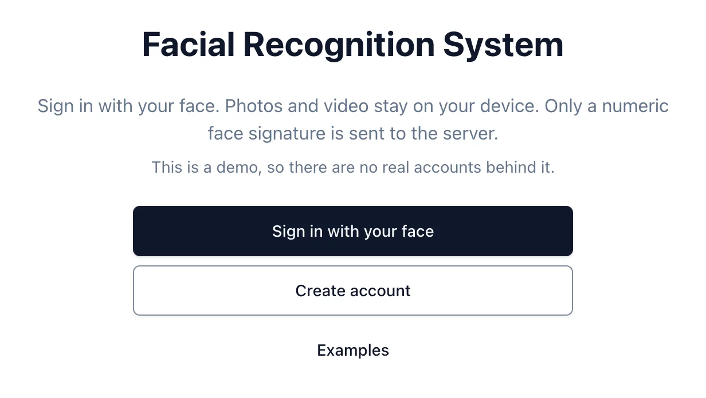

**2. Enter your name and email.** Your name is used to greet you, and your email identifies your face profile.

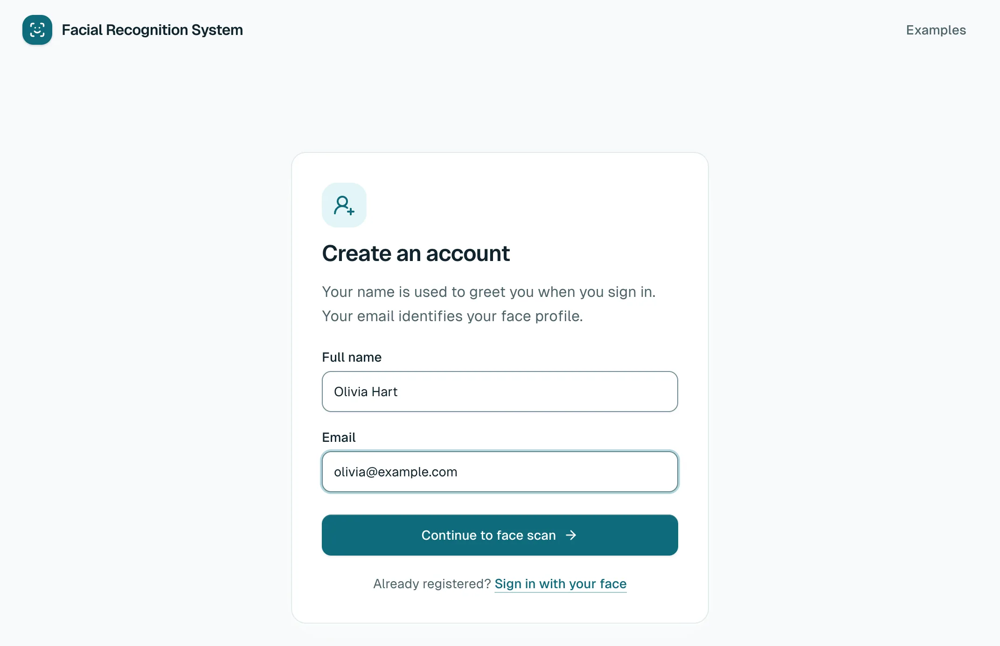

**3. Read what happens to your data.** The camera stays off until you choose **I agree, turn on camera**. Your
browser then asks for camera permission.

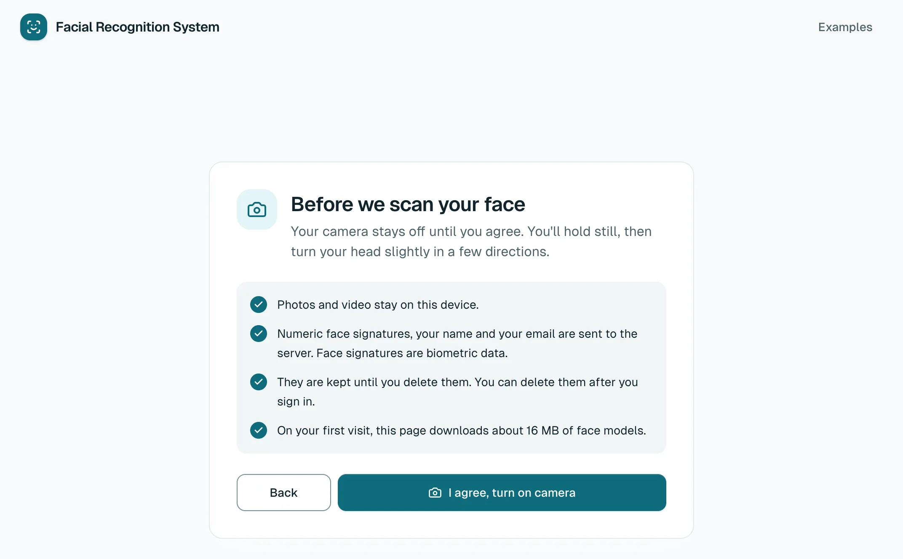

**4. Follow the guide.** Look straight ahead, then turn left, right, up and down as asked. There is no shutter
button: samples are taken automatically when your pose and the image quality are good. The pills show your
progress.

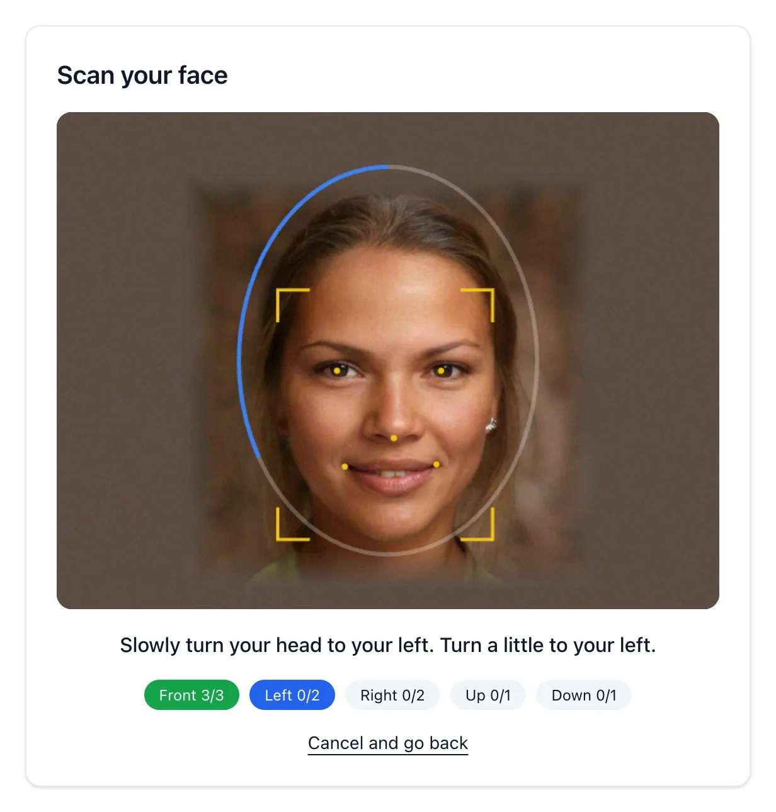

**5. You're registered.** The app takes you to sign-in automatically.

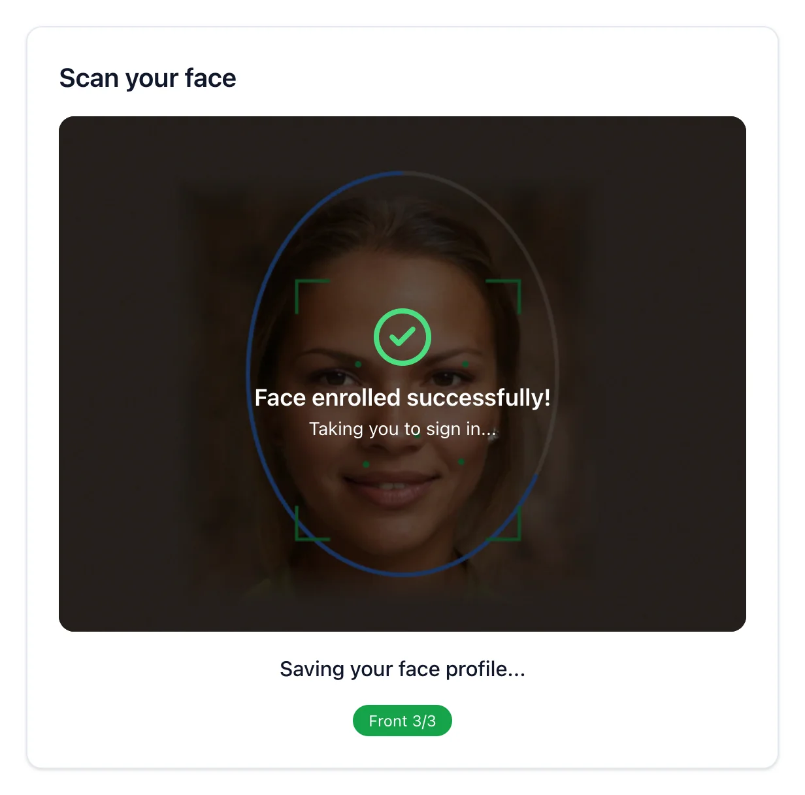

### Sign in

**1. Turn on the camera.** Open <http://localhost:3000/face/login> and choose **Turn on camera**.

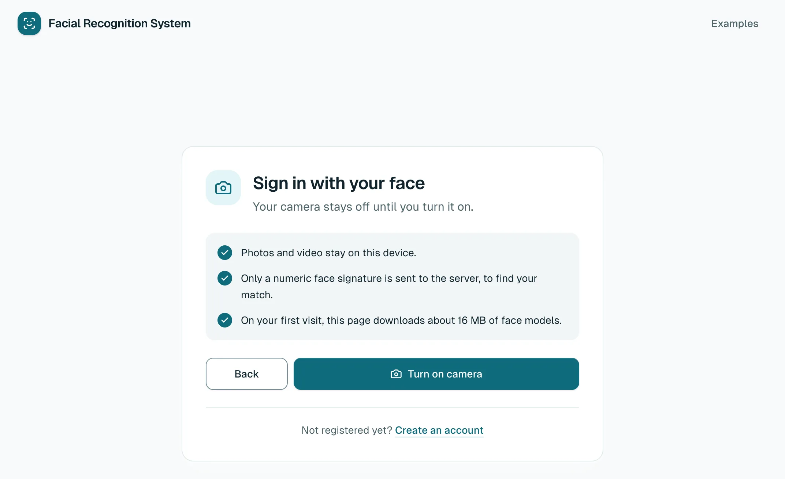

**2. Look at the camera and blink.** A printed photo or still image is refused because it can't blink.

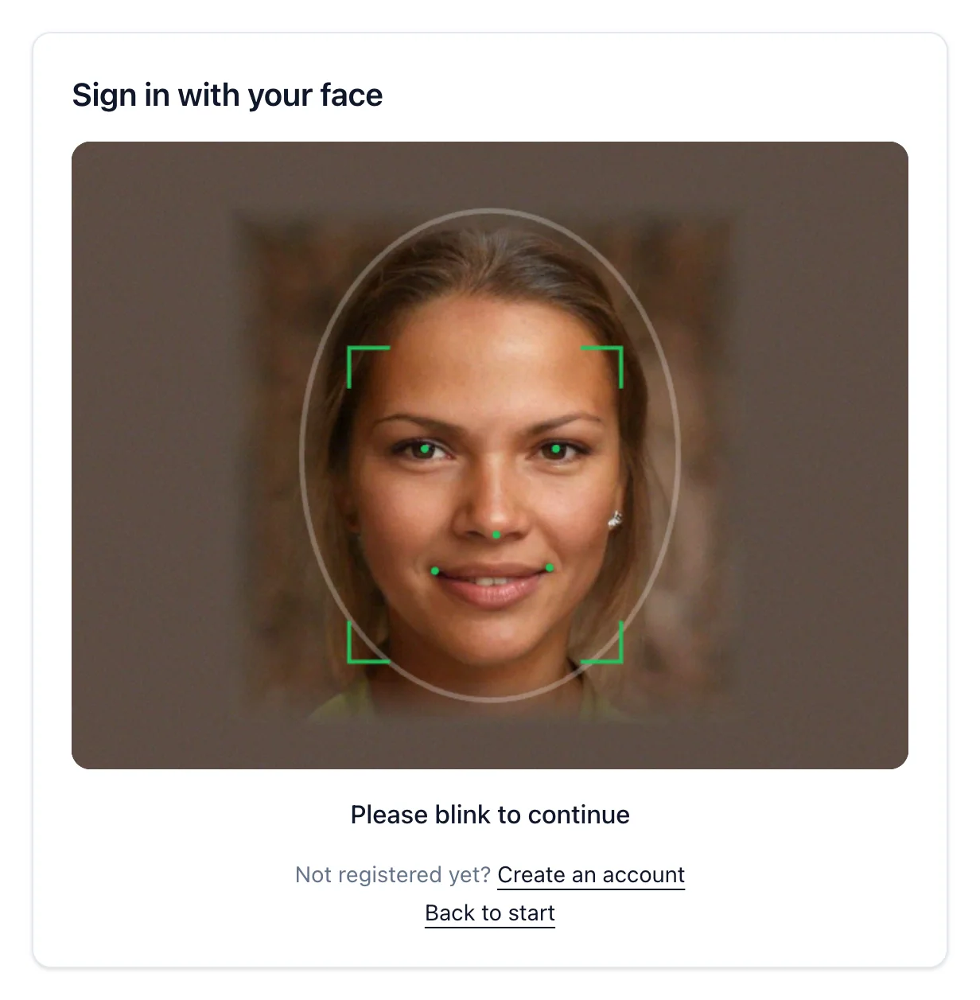

**3. You're recognised.**

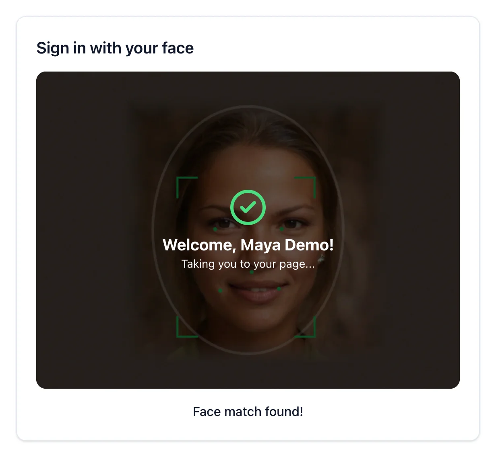

**4. Your page shows who you were matched as.** If that isn't you, choose **Not you? Try again**.

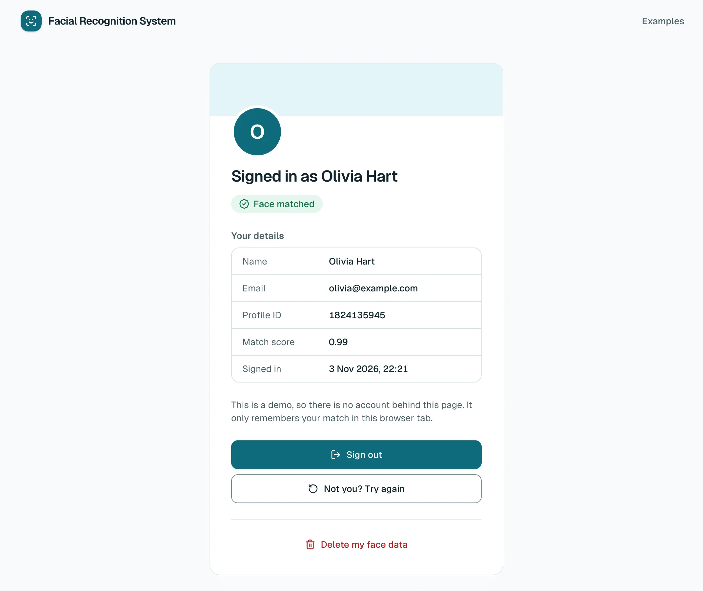

### Delete your face data

Choose **Delete my face data**, then **Delete permanently**. This removes your face signatures, name and email from
the server, and you would need to register again to sign in.

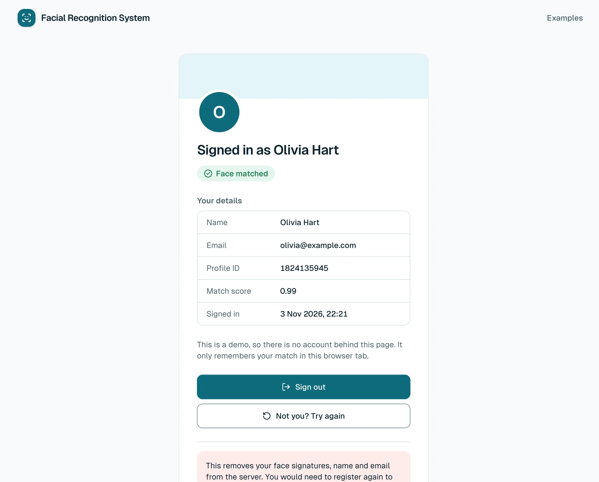

### If the camera is blocked

The app tells you what went wrong and how to fix it. Allow the camera in your browser's site settings, then choose
**Try again**.

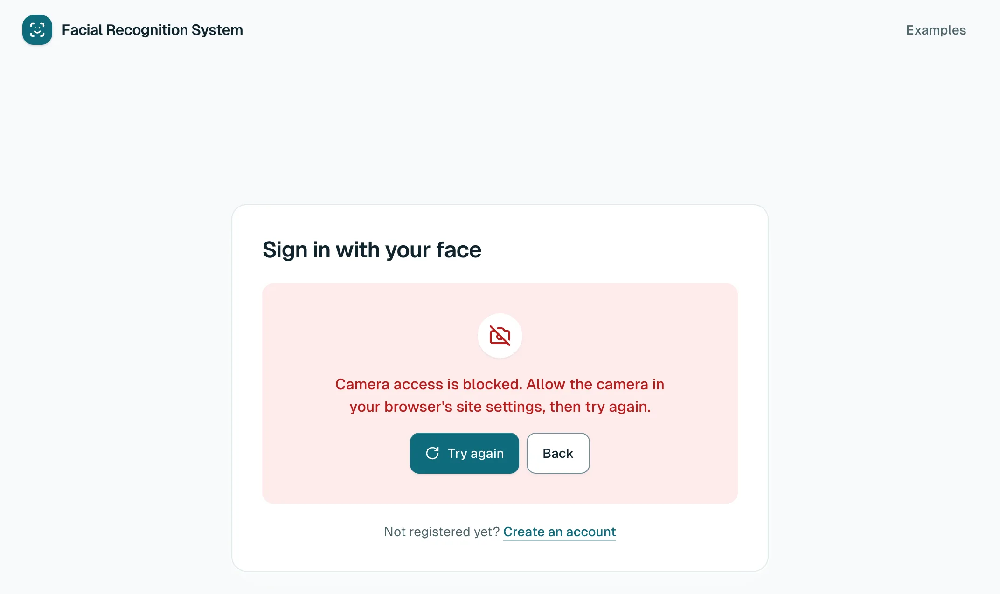

### On a phone

The web app works in a phone browser too, but the camera needs https, so use a deployed copy (see
[section 9](#9-deploy-on-the-web-for-free)) or the [mobile app](#7-mobile-app).

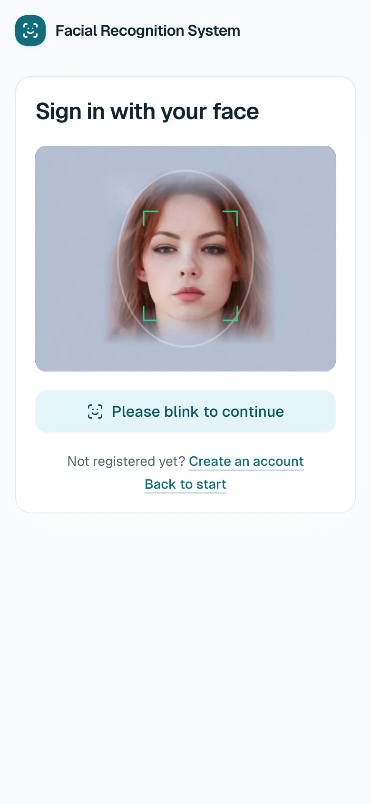

## 4. Explore the examples

| Page | Shows |
| --- | --- |
| `/examples/pipeline` | live timings for each stage, head pose, quality, the aligned crop, similarity to a reference |
| `/examples/compare` | two photos compared in the browser; nothing is uploaded |
| `/examples` | index, including a quick frontal-only registration |

**Pipeline inspector:** see the speed on your own device. These are the numbers behind the
[benchmarks](benchmarks.md).

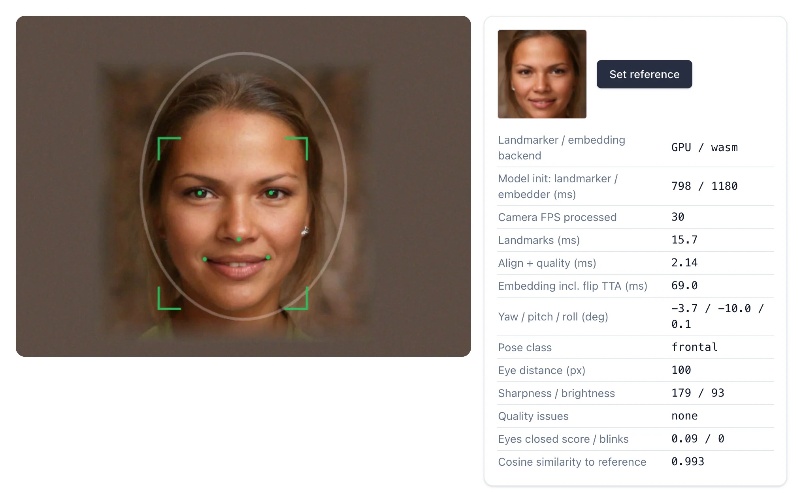

**Compare two photos:** pick any two images to see how similar the model finds them.

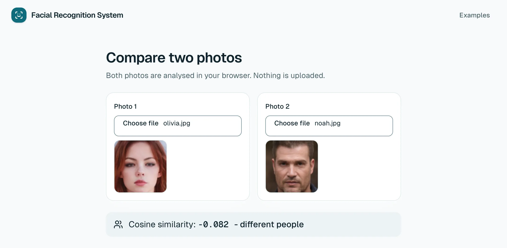

## 5. Use the API

The API takes embeddings, not images. Replace `$API` with `http://localhost:5000`, and generate a test vector
to try it without a camera:

```bash
export API=http://localhost:5000

# a random unit vector, standing in for what a client computes from a face
EMB=$(python3 -c "
import random, math, json
v = [random.gauss(0, 1) for _ in range(512)]
n = math.sqrt(sum(x * x for x in v))
print(json.dumps([x / n for x in v]))")
```

**Register a person**

```bash
curl -s -X POST $API/api/v1/embeddings/register -H 'Content-Type: application/json' -d "{
  \"model\": \"w600k_mbf\",
  \"person\": {\"person_id\": 1001, \"name\": \"Ada Lovelace\", \"email\": \"ada@example.com\"},
  \"samples\": [{\"embedding\": $EMB, \"pose_label\": \"frontal\", \"pose\": {\"yaw\": 0, \"pitch\": 0, \"roll\": 0}, \"quality\": 0.9}]
}"
```

**Identify**

```bash
curl -s -X POST $API/api/v1/embeddings/identify -H 'Content-Type: application/json' -d "{
  \"model\": \"w600k_mbf\", \"embedding\": $EMB
}"
```

The response has the decision, the score and the matched person:

```json
{ "status": "...", "reason": "...", "score": 1.0, "person": { "person_id": 1001, "name": "Ada Lovelace" } }
```

**Delete a person**

```bash
curl -s -X DELETE "$API/api/v1/embeddings/persons/1001?model=w600k_mbf"
```

**From photos, in Python.** `backend/frs/examples/client_embedding_demo.py` computes embeddings the same way
the clients do, which is useful for enrolling from photos and tuning thresholds:

```bash
cd backend/frs
pip install -r requirements-dev.txt
python examples/client_embedding_demo.py embed    --image samples/480.jpg
python examples/client_embedding_demo.py register --image samples/480.jpg --name "Ada" --email ada@example.com
python examples/client_embedding_demo.py identify --image samples/480.jpg
```

## 6. Local development

**You need:** Node.js 22.12+ and Python 3.12+.

```bash
# terminal 1 - API with a throw-away in-memory database
cd backend/frs
pip install -r requirements-dev.txt
QDRANT_LOCATION=:memory: uvicorn main:app --reload --port 5000

# terminal 2 - web app (the first start downloads the models into public/)
cd frontend/frs_react
npm install
npm run dev
```

Tests, as run by CI:

```bash
cd backend/frs && pytest
cd frontend/frs_react && npm test && npm run lint && npx tsc --noEmit
cd mobile/face_app && flutter analyze && flutter test
```

The pipeline exists in Python, TypeScript and Dart, and all three must stay identical. See the Architecture
section of `CLAUDE.md` before changing alignment, preprocessing, pose or embedding logic.

## 7. Mobile app

```bash
cd mobile/face_app
tool/setup_models.sh
flutter run --dart-define=FRS_API=http://<your-lan-ip>:5000
```

The Compose stack publishes the API on port 5000, so a phone on the same network can use it. Web, mobile and
backend share one vector space: a face registered on the phone can log in on the web.

## 8. Configuration

Compose reads an optional `.env` file next to `docker-compose.yml` (see `.env.example`):

| Variable | Default | |
| --- | --- | --- |
| `FRS_IMAGE_NAMESPACE` | empty | Docker Hub user to pull images from; empty means build locally |
| `FRS_TAG` | `latest` | image tag |
| `FRS_WEB_PORT` / `FRS_API_PORT` | `3000` / `5000` | published ports |
| `FRS_WORKERS` | `2` | API worker processes |
| `FRS_MATCH_THRESHOLD` / `FRS_MATCH_MARGIN` | `0.45` / `0.05` | match acceptance |
| `FRS_CORS_ORIGINS` | `http://localhost:3000` | origins allowed to call the API directly |

All API variables: [backend README](../backend/frs/README.md#configuration). Web variables:
`frontend/frs_react/.env.example`.

## 9. Deploy on the web for free

Follow [deploy-free.md](deploy-free.md): Vercel for the web app and API, and Qdrant Cloud for the database.
It takes about 15 minutes.

## 10. Troubleshooting

| Symptom | Fix |
| --- | --- |
| Camera does not start | Browsers only allow the camera on https or `localhost`. Check the site's camera permission. |
| Login keeps asking you to blink | Face the light and blink fully. For a demo, build the web image with `--build-arg NEXT_PUBLIC_REQUIRE_BLINK=false`. |
| Port already in use | Set `FRS_WEB_PORT` / `FRS_API_PORT` in `.env`. On a Mac, port 5000 is often AirPlay Receiver. |
| `docker compose up` fails while building the web image | The build downloads the models from GitHub and Google Storage, so check network access and retry. |
| Web app says "Can't reach the server" | Check `docker compose logs api`. The API waits for Qdrant to become healthy before starting. |
| Start again from scratch | `docker compose down -v` deletes all registered faces. |

> **Security note.** This project is a demo of the on-device approach. Before exposing it publicly, read the
> security notes in [client-side-embeddings.md](client-side-embeddings.md): `register` and `delete` are not
> authenticated, and the bundled model weights are licensed for non-commercial research only.
